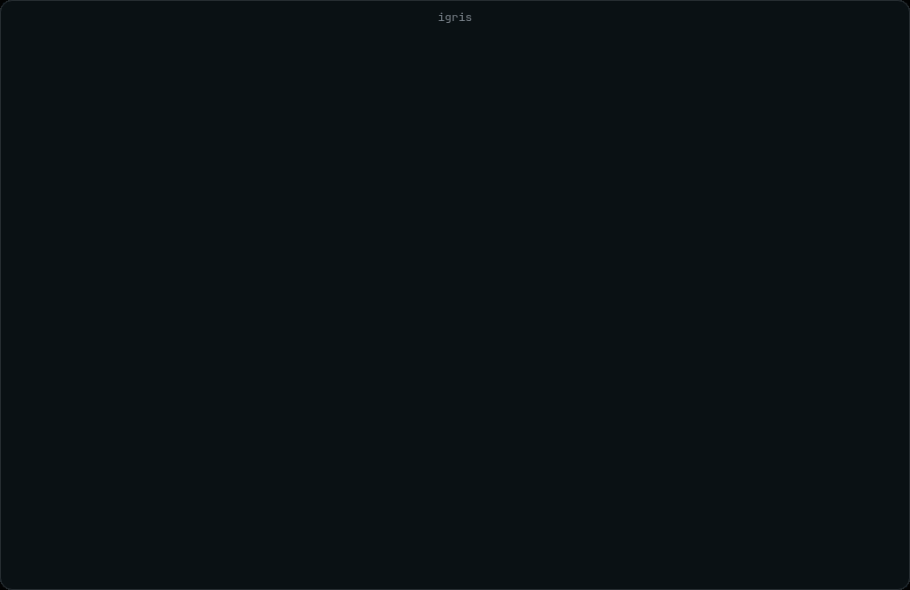
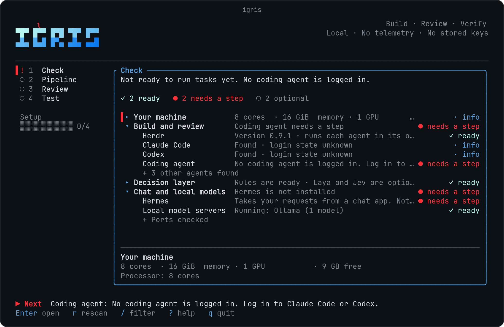

<p align="center"></p>

<p align="center"><b>Build · Review · Verify</b><br>AI coding agents on your own machine.</p>

<p align="center"></p>

IGRIS sets up a small team of AI coding tools on your own machine and keeps them honest. One agent builds, another reviews, and a test command you choose decides when the work is done. Anything risky waits for your yes.

You run it from a terminal, with the keyboard, the mouse, or both. It checks what you already have, helps you fix what is missing, writes one small config file, and tests that the whole pipeline works before it touches your code.

## Get started

1. **Install IGRIS** (no Rust needed, no administrator rights; it checks the download's SHA-256 before it installs).

   macOS and Linux:

   ```sh
   curl -fsSL https://raw.githubusercontent.com/JlassiRafet/IGRIS/main/scripts/install.sh | IGRIS_VERSION=v0.1.0-rc1 sh
   ```

   Windows (PowerShell):

   ```powershell
   $env:IGRIS_VERSION = "v0.1.0-rc1"; irm https://raw.githubusercontent.com/JlassiRafet/IGRIS/main/scripts/install.ps1 | iex
   ```

2. **Open a terminal in a git repository.**
3. **Start it:**

   ```sh
   igris
   ```

`IGRIS_VERSION` is only needed while IGRIS has pre-releases and no stable one. With Rust installed you can build it instead: `cargo install --git https://github.com/JlassiRafet/IGRIS igris`.

## Checking your machine

The first screen scans in a second or two and lists what it found: your hardware, [Herdr](https://herdr.dev) (it runs each agent in its own pane), the coding agents on your `PATH` and whether they are logged in, the decision layer, Hermes and any local model servers. Each row says ready, needs a step, or optional. Open a row to see the fix; for a login or the Herdr install, IGRIS runs the tool's own documented command after you say yes.



## Setting up the pipeline

Pick the builder and the reviewer from the agents it found, and set the command that proves a task is done, such as `cargo test` or `npm test`. Every field validates as you type and explains itself underneath.


## Reviewing before anything is written

Review shows the exact change to `igris.toml`, as a diff, before it writes. If the file already exists, the old one is kept as `igris.toml.bak`. You can write to the repository or to your user config.


## Testing it

Test runs the same checks as `igris doctor` and can run a small sample task through your own agents, so you know the pipeline works before you give it real work.


## How a task runs

One task, start to finish. You ask in a chat app, or run `igris run` yourself. IGRIS answers four questions (which agent, how big, how risky, does it need your yes) and starts the builder in its own worktree. A different agent reviews the diff, then your check command runs in the shell. Exit code 0 and an approving review mean done; merging still waits for you. A task that touches migrations, `auth`, `.env` files or SQL stops and asks first.


The example is a rate-limiting task: Codex asks for one change, Claude Code makes it, the checks pass, and merging waits for you.

## Headless

Every check has a command, for scripts and CI. Results are JSON on stdout, and the exit code says what happened.

| Command | What it does |
|---|---|
| `igris doctor` | Checks the config, Herdr, both agents and the repository. `--json` adds the machine report: hardware, local models, agents and their logins. |
| `igris run --task "…"` | Runs one task through build, review and your check command. Risky changes wait unless you pass `--approved`. |
| `igris status [id]` | Lists tasks, or shows one in full. |
| `igris continue` | Continues a task that was waiting for you in Herdr. |
| `igris merge` | Merges an approved, green task into its base branch (fast-forward only). |

`igris --no-mouse` keeps your terminal's own text selection. `?` in the app shows every key and `q` quits. A font with Braille and block characters looks best; `IGRIS_NO_MOTION=1` stops the animation.

## What you bring

IGRIS does not resell or proxy any model. Each tool uses your own subscription or API key and keeps its own login.

## Contributing

Clone the repo, then run the same four checks CI runs: `cargo fmt --check`, `cargo clippy --all-targets -- -D warnings`, `cargo test`, `cargo deny check`. [CONTRIBUTING.md](CONTRIBUTING.md) has the rest. The screenshots and GIFs above are rebuilt from the real app by `scripts/preview.py`.

## Privacy

IGRIS has no telemetry, no analytics and no network library in the build. It never stores a login or a key. It only runs fixed commands: a tool's own login, and the documented Herdr installer after you say yes. Your code and your tasks stay on your machine, apart from what your own agents send to their own providers.

## License

Apache-2.0. See [LICENSE](LICENSE) and [NOTICE](NOTICE).
