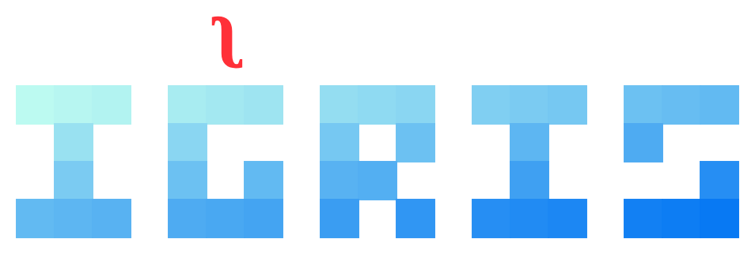
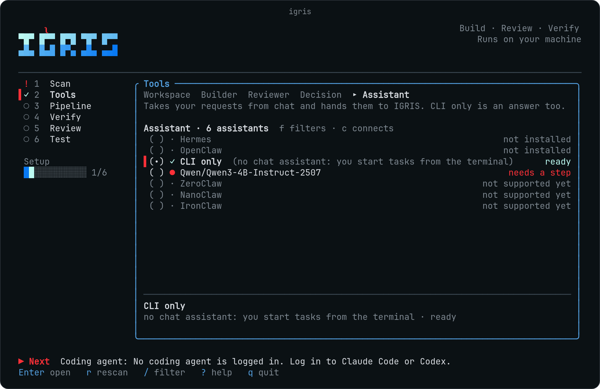
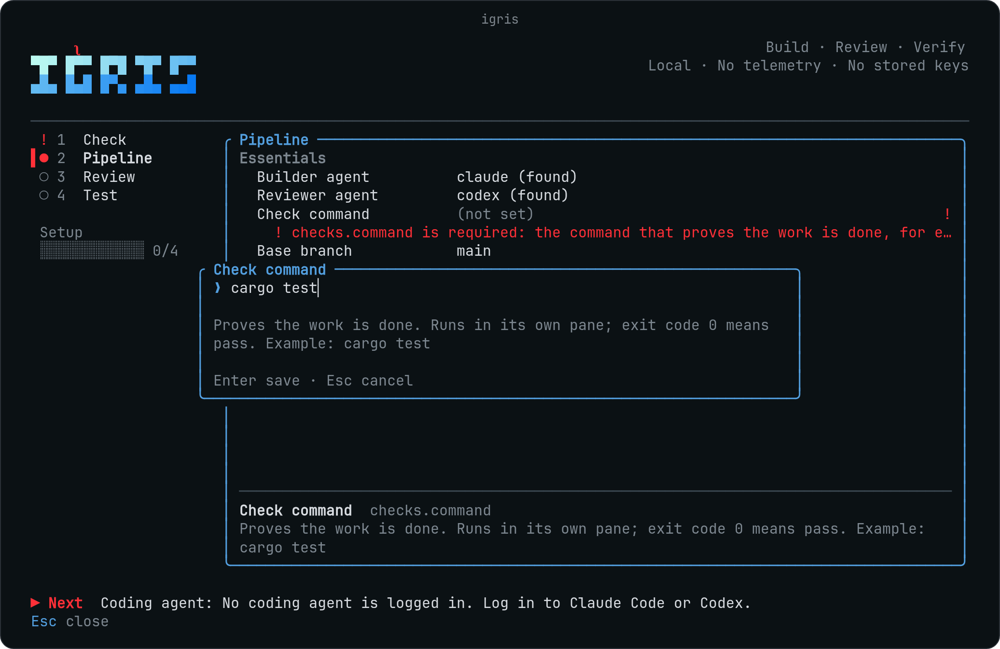
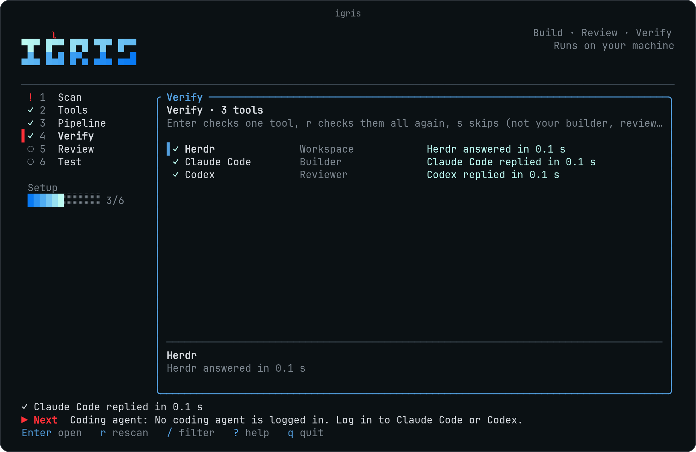
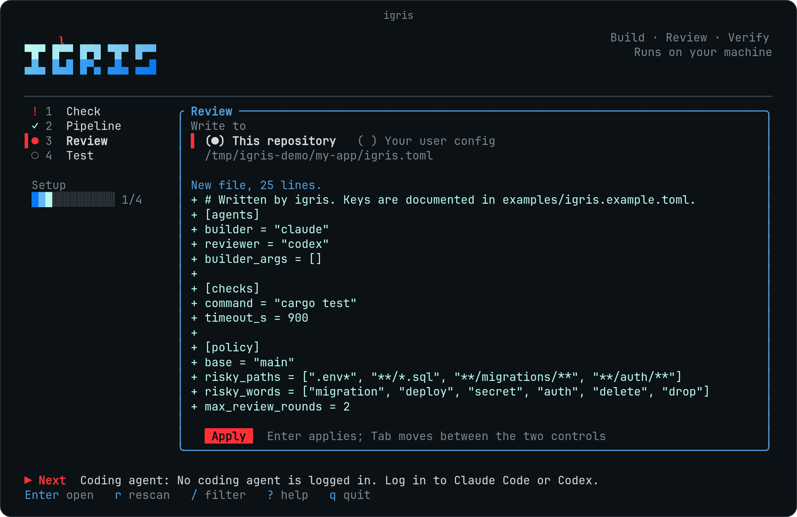
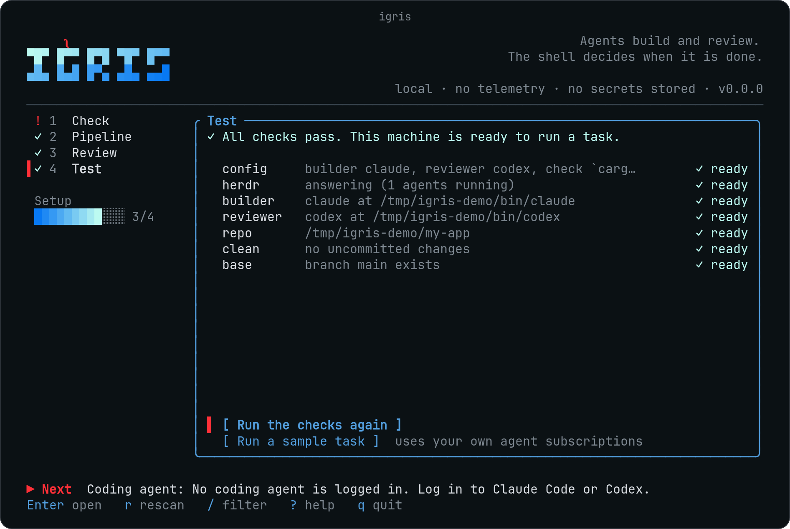
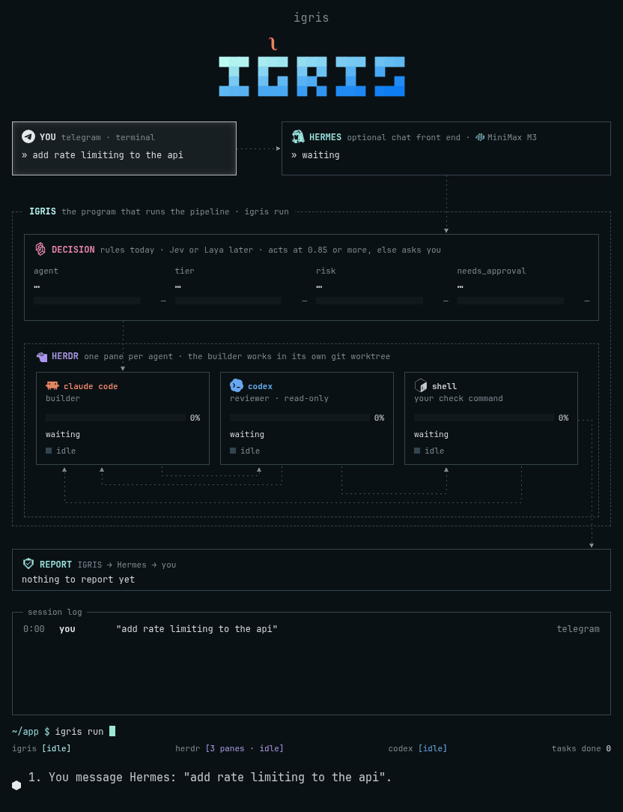

<p align="center"></p>

<p align="center"><b>Build · Review · Verify</b><br>AI coding agents on your own machine.</p>

<p align="center"></p>

IGRIS sets up a small team of AI coding tools on your own machine and keeps them honest. One agent builds, another reviews, and a test command you choose decides when the work is done. Anything risky waits for your yes.

You run it from a terminal, with the keyboard, the mouse, or both. It checks what you already have, helps you fix what is missing, writes one small config file, and tests that the whole pipeline works before it touches your code.

## Get started

1. **Install IGRIS** (no Rust needed, no administrator rights; it checks the download's SHA-256 before it installs).

   macOS and Linux:

   ```sh
   curl -fsSL https://raw.githubusercontent.com/JlassiRafet/IGRIS/main/scripts/install.sh | IGRIS_VERSION=v0.1.0-rc2 sh
   ```

   Windows (PowerShell):

   ```powershell
   $env:IGRIS_VERSION = "v0.1.0-rc2"; irm https://raw.githubusercontent.com/JlassiRafet/IGRIS/main/scripts/install.ps1 | iex
   ```

2. **Open a terminal in a git repository.**
3. **Start it:**

   ```sh
   igris
   ```

`IGRIS_VERSION` is only needed while IGRIS has pre-releases and no stable one. With Rust installed you can build it instead: `cargo install --git https://github.com/JlassiRafet/IGRIS igris`.

## Setting up, in six steps

The rail on the left lists the steps; keys `1` to `6` jump to one, and the `Next` row under the panel names what to do now.

1. **Scan** finds what you already have in a second or two: your hardware, [Herdr](https://herdr.dev) (it runs each agent in its own pane), the coding agents on your `PATH` and whether they are logged in, the decision layer, Hermes and any local model servers. Each row says ready, needs a step, or optional.
2. **Tools** is where you choose: the workspace (Herdr), the builder, the reviewer, the decision layer and the assistant that takes your requests from chat. "CLI only" is an answer: you then start tasks from the terminal. Press `Enter` on a tool that is missing to install it, `c` to connect it (a login, or an API key typed into a masked box that goes straight to the tool's own command), `f` to filter. IGRIS runs only the tool's own documented command, after you say yes, and stops it if you quit. On a small machine it suggests local models that fit, judged by [llmfit](https://github.com/AlexsJones/llmfit) when it is installed.
3. **Pipeline** sets the command that proves a task is done, such as `cargo test` or `npm test`. Every field validates as you type and explains itself underneath.
4. **Verify** runs one live check per chosen tool and shows how long each took. Review stays locked until they pass. The builder, the reviewer and Herdr cannot be skipped. (A check of an agent is a real, tiny model call.)
5. **Review** shows the exact change before anything is written.
6. **Test** runs the same checks as `igris doctor`, and can run a small sample task through your own agents.








## Reviewing before anything is written

Step 5 shows the exact change to `igris.toml`, as a diff, before it writes. If the file already exists, the old one is kept as `igris.toml.bak`. You can write to the repository or to your user config.



## Testing it

Step 6 runs the same checks as `igris doctor` and can run a small sample task through your own agents, so you know the pipeline works before you give it real work. When the sample is green, a **Next steps** box lists the commands to use next (`igris run`, `igris doctor`, `igris continue`) and, if you chose Hermes or CLI only, how to add the chat skill.



## How a task runs

One task, start to finish. You ask in a chat app, or run `igris run` yourself. IGRIS answers four questions (which agent, how big, how risky, does it need your yes) and starts the builder in its own worktree. A different agent reviews the diff, then your check command runs in the shell. Exit code 0 and an approving review mean done; merging still waits for you. A task that touches migrations, `auth`, `.env` files or SQL stops and asks first.



The example is a rate-limiting task: Codex asks for one change, Claude Code makes it, the checks pass, and merging waits for you.

## Run a task

```sh
igris run --task "fix the failing cart test"
```

IGRIS answers its four questions, starts the builder in a Herdr pane in its own git worktree, has the reviewer read the diff, then runs your check command. The result is one JSON document, and the exit code says where it ended: `0` done, `3` not done (it needs your yes, or an agent is waiting on a question), `1` failed. When it is done, `igris merge <id>` merges it.

The first time an agent works in a new folder it asks you a question inside its Herdr pane, for example whether you trust the folder. IGRIS reports the task as `blocked`: answer in Herdr, then run `igris continue <id>`. For the folder-trust dialog of Claude Code or Codex you can let IGRIS answer it: `igris continue <id> --yes` presses the keys only when the screen is that exact dialog in this task's own worktree, and tells you what it saw otherwise. The agent's own trust list is not touched by IGRIS, and an update prompt or any other question is always yours to answer.

## Chat with it

[Hermes](https://hermes-agent.nousresearch.com) can take your requests from a chat app such as Telegram and run them through IGRIS. Copy [`examples/hermes/igris/SKILL.md`](examples/hermes/igris/SKILL.md) to `~/.hermes/skills/igris/SKILL.md`. It tells Hermes how to call `igris run`, what the exit codes mean, and to ask you before anything risky or before a merge.

Hermes needs a model with a context window of at least 64,000 tokens that can call tools. To keep everything on your machine, use a local one with [Ollama](https://ollama.com):

```sh
ollama pull qwen3:4b-instruct-2507-q4_K_M
OLLAMA_CONTEXT_LENGTH=65536 OLLAMA_FLASH_ATTENTION=1 OLLAMA_KV_CACHE_TYPE=q4_0 ollama serve
hermes config set model.provider custom
hermes config set model.base_url http://127.0.0.1:11434/v1
hermes config set model.default qwen3:4b-instruct-2507-q4_K_M
```

We ran the whole chain this way on an 8-core laptop with 4 GB of GPU memory: Hermes started the task, IGRIS reported it blocked on a trust prompt, and after the answer in Herdr, Hermes continued it and merged it. A 4B model needs the exact command in the request (`run igris run --repo … --task "…"`); a 3B model answered chat but did not call tools. A larger model follows the skill more reliably.

## Headless

Every check has a command, for scripts and CI. Results are JSON on stdout, and the exit code says what happened.

| Command | What it does |
|---|---|
| `igris doctor` | Checks the config, Herdr, both agents and the repository. `--json` adds the machine report: hardware, local models, agents and their logins. |
| `igris run --task "…"` | Runs one task through build, review and your check command. Risky changes wait unless you pass `--approved`. |
| `igris status [id]` | Lists tasks, or shows one in full. |
| `igris continue` | Continues a task that was waiting for you in Herdr. `--yes` first answers a recorded folder-trust dialog. |
| `igris merge` | Merges an approved, green task into its base branch (fast-forward only). |

`igris --no-mouse` keeps your terminal's own text selection. `?` in the app shows every key and `q` quits. A font with Braille and block characters looks best; `IGRIS_NO_MOTION=1` stops the animation.

## What you bring

IGRIS does not resell or proxy any model. Each tool uses your own subscription or API key and keeps its own login.

## Contributing

Clone the repo, then run the same four checks CI runs: `cargo fmt --check`, `cargo clippy --all-targets -- -D warnings`, `cargo test`, `cargo deny check`. [CONTRIBUTING.md](CONTRIBUTING.md) has the rest. The screenshots and GIFs above are rebuilt from the real app by `scripts/preview.py`.

## Privacy

IGRIS has no telemetry, no analytics and no network library in the build. It never stores a login or a key. It only runs fixed commands: a tool's own login, and the documented Herdr installer after you say yes. Your code and your tasks stay on your machine, apart from what your own agents send to their own providers.

## License

Apache-2.0. See [LICENSE](LICENSE) and [NOTICE](NOTICE).
